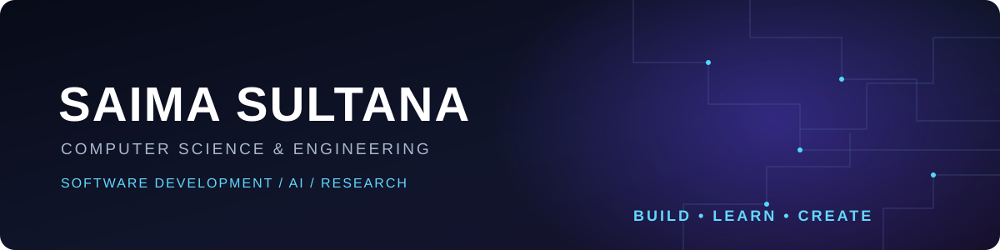

# Hi, I'm Saima 👋

🎓 **Metropolitan University** | B.Sc. in Computer Science & Engineering

💻 Software Development | 🤖 AI & Research

I enjoy exploring technology, building practical projects, and learning how intelligent systems work.

---

## 👩🏻‍💻 About Me

- 🎓 Studying Computer Science and Engineering
- 💻 Exploring programming and software development
- 🤖 Working on LLM-based memory optimization research
- 🧠 Interested in Machine Learning and intelligent applications
- 🧬 Exploring Bioinformatics
- 🌱 Learning through experimentation and practical projects

---

## 🧰 Tech Stack & Tools

### Programming Languages

### Web Development

### AI, Machine Learning & Data

### Development Tools

---

## 🚀 Featured Projects

| Project | Description | Technology |
|---|---|---|
| [LLM-Based Memory Optimization](https://github.com/saima-231/LLM_Based_Memory_Optimization) | Selective memory storage and retrieval for conversational AI | Python |
| [Smart Grocery Expiry Predictor](https://github.com/saima-231/Smart-Grocery-Expiry-Predictor) | Grocery expiry prediction using Linear Regression and KNN | Python, ML |
| [CareerMatch](https://github.com/saima-231/CareerMatch) | Internship management and recruitment platform | PHP |
| [Personal Habit Drift Detection](https://github.com/saima-231/Personal_Habit_Drift_Detection) | Exploring patterns in personal habits | Python |

---

## 📊 GitHub Analytics

### Most Used Languages

### GitHub Statistics

### Contribution Streak

---

## 📅 Contribution Activity

---

## 🤝 Connect With Me

  
  
  
  

---

*Curiosity drives learning. Building turns ideas into reality.*

